<p><picture><source media="(max-width: 600px)" srcset="assets/readme/hero-mobile.svg"/>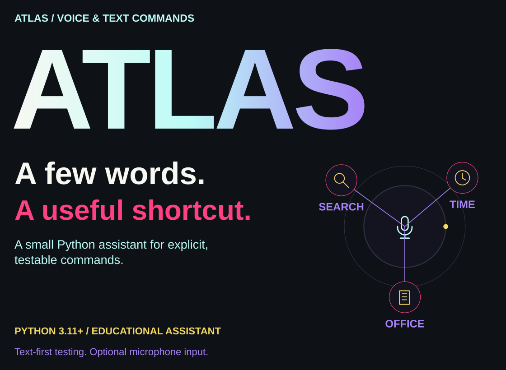</picture></p>

<p align="center"><a href="#try-it">Try it</a> · <a href="#commands">Commands</a> · <a href="#how-commands-work">How it works</a> · <a href="#privacy-and-configuration">Privacy</a> · <a href="#explore-the-code">Explore</a></p>

A small Python assistant for voice commands, web search, Wikipedia lookup and Windows Office launch. Originally built by Adil Sukumar; this public edition separates command parsing from microphone and desktop actions.

<a id="try-it"></a>

##  Try it

<p><picture><source media="(max-width: 600px)" srcset="assets/readme/modes-mobile.svg"/>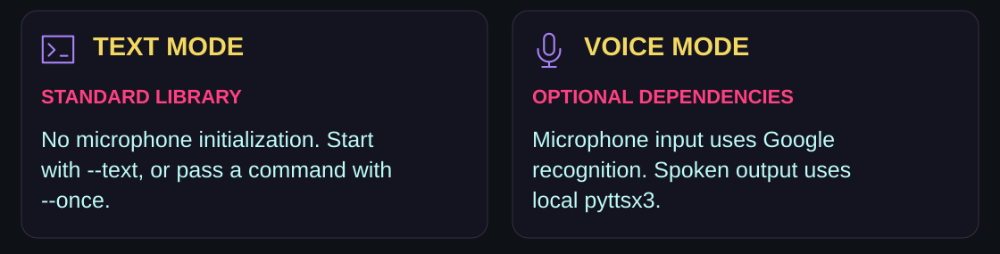</picture></p>

<p><picture><source media="(max-width: 600px)" srcset="assets/readme/dry-run-mobile.svg"/>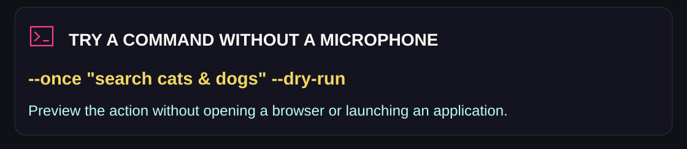</picture></p>

Python 3.11 or later. Text mode uses only the standard library:

```sh
python atlas.py --text
python atlas.py --once "search cats & dogs" --dry-run
python -m unittest discover -s tests -v
```

For microphone input and spoken output:

```sh
python -m venv .venv
# Windows: .venv\Scripts\activate
python -m pip install -r requirements-voice.txt
python atlas.py
```

PyAudio requires a working PortAudio/audio-device setup. Use text mode when no microphone is available. Word and Excel must be installed locally for their launch commands.

<a id="commands"></a>

##  Commands

<p><picture><source media="(max-width: 600px)" srcset="assets/readme/commands-mobile.svg"/>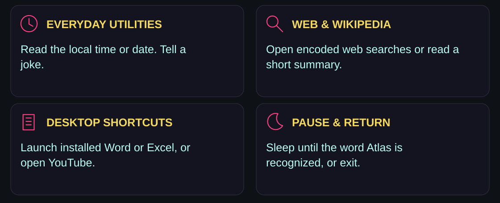</picture></p>

| Say or type | Action |
|---|---|
| `time`, `date` | Read the local time or date |
| `open word`, `open excel` | Launch the installed Windows application |
| `open youtube` | Open YouTube in the default browser |
| `search for orbital mechanics` | Open an encoded Google search |
| `search wikipedia Ada Lovelace` | Read a short Wikipedia summary |
| `tell me a joke` | Tell a joke |
| `sleep`, then `hey Atlas` | Pause command handling until the wake word |
| `exit` | Close the assistant |

`--dry-run` suppresses application launch, browser navigation and Wikipedia requests. `--once` processes one supplied command without opening a microphone. Sleep-mode wake matching checks the word Atlas; it does not authenticate the speaker.

<a id="how-commands-work"></a>

##  How commands work

<p><picture><source media="(max-width: 600px)" srcset="assets/readme/pipeline-mobile.svg"/>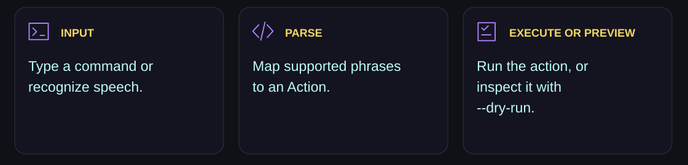</picture></p>

The parser returns an explicit action type. Microphone setup and desktop actions are kept separate from command parsing so the command path can be inspected and tested.

<a id="privacy-and-configuration"></a>

##  Privacy and configuration

<p><picture><source media="(max-width: 600px)" srcset="assets/readme/privacy-mobile.svg"/>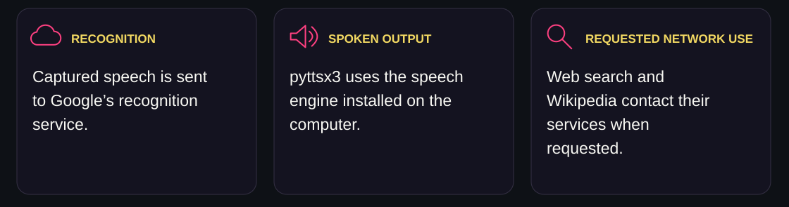</picture></p>

Voice recognition sends captured speech to Google's recognition service. Text mode does not use the microphone. Speech output uses the locally installed pyttsx3 engine. Web search/Wikipedia contact their respective services when requested. Atlas does not record audio to the repository or include a personal address book.

The optional `send_email` Python helper requires explicit recipient details and environment-provided credentials, uses TLS, and closes its SMTP session. It is not connected to recognized speech. No email is sent by tests.

##  Public edition fixes

- Removed embedded credentials, contact addresses, recordings, drivers and downloaded wheels.
- Fixed the always-true wake-word expression and ignored lowercase conversion.
- Removed import-time microphone access and unbounded background-listener sleep.
- Added bounded listening, graceful recognition failure and reusable speech output.
- Added dependency-free command tests and dry-run operation.

This is a command-based educational assistant, not an unrestricted autonomous desktop agent. Microphone and physical Office launch need testing on the target computer.

<a id="explore-the-code"></a>

##  Explore the code

<p align="center"><a href="atlas.py">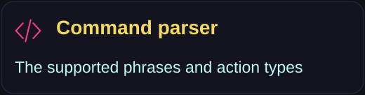</a> <a href="tests/test_atlas.py">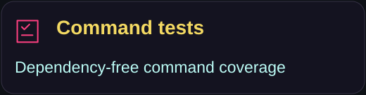</a> <a href="requirements-voice.txt">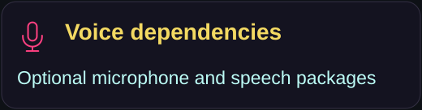</a> <a href=".env.example">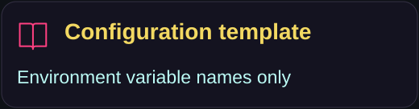</a></p>

<p><picture><source media="(max-width: 600px)" srcset="assets/readme/closing-mobile.svg"/>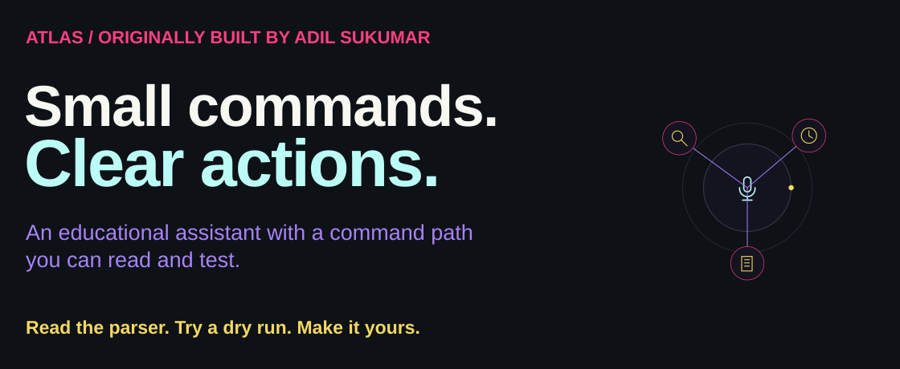</picture></p>

<p align="center"><a href="https://github.com/adilsukumar/Atlas-Voice-Assistant/issues">Discuss an improvement</a> · <a href="tests/test_atlas.py">Inspect the tests</a> · <a href="https://www.adilsukumar.xyz/">Meet the builder</a></p>
